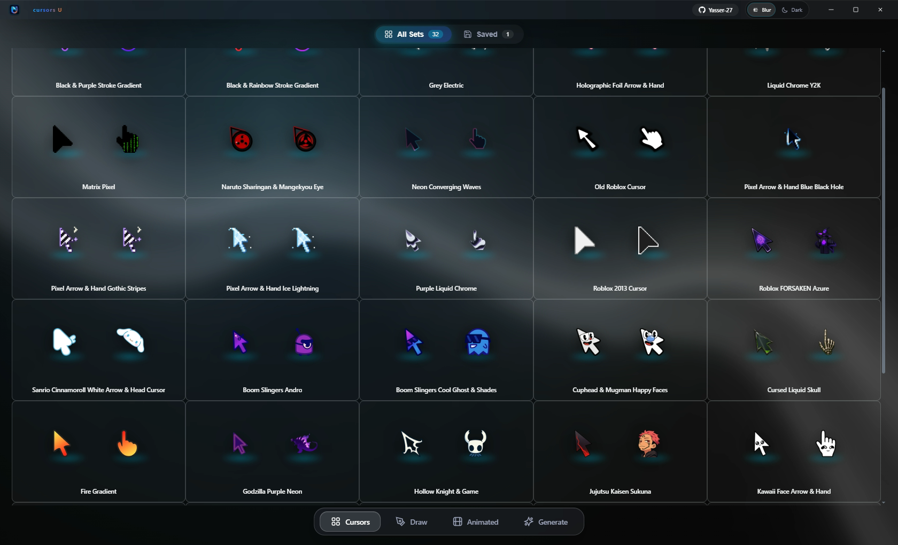

<p align='center'>

  

</p>

### app for browsing, designing, animating, testing, and exporting custom mouse cursors.





## Getting started

```powershell
git clone https://github.com/YASSER-27/CursorsU.git
cd CursorsU
npm ci
npm run dev
```

## Build

Build the renderer:

```powershell
npm run build
```

Build the Windows x64 NSIS installer:

```powershell
npm run dist:win
```

